```ascii
██████╗ ███╗   ███╗██╗    ██╗
██╔══██╗████╗ ████║██║    ██║
██████╔╝██╔████╔██║██║ █╗ ██║
██╔══██╗██║╚██╔╝██║██║███╗██║
██║  ██║██║ ╚═╝ ██║╚███╔███╔╝
╚═╝  ╚═╝╚═╝     ╚═╝ ╚══╝╚══╝

ReadMyWidgets: widgets en SVG para tu README de perfil
by Hex (@RemiH06)          version 1.0.0
```


---

## Descripción general

**ReadMyWidgets** es una GitHub Action que genera fichas de repositorio y otros
widgets como SVG estáticos para el README de tu perfil. Cada archivo es
autocontenido (fuente e íconos incrustados, sin peticiones externas ni
JavaScript), pesa menos de 100 KB y sale en versión oscura y clara para que
GitHub muestre la que corresponde al tema de quien lo ve.

La ficha está pensada como la cédula que acompaña a una obra en un museo:
texto sobrio y jerarquía clara, para acompañar el resto de tu perfil sin
competir con él. Los datos salen de la API de GitHub; lo único que GitHub no
sabe, el estado de cada proyecto, lo das tú.

## Galería

<table>
  <tr><th>Widget</th><th>Vista</th></tr>
  <tr>
    <td><b>Ficha</b><br><code>layout: card</code><br>Nombre, técnica y fecha, descripción en 2 líneas, barra y leyenda de lenguajes.</td>
    <td><a href="https://github.com/RemiH06/tanGo"><picture><source media="(prefers-color-scheme: dark)" srcset="docs/gallery/card/card-tanGo-dark.svg">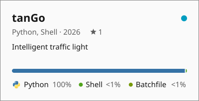</picture></a></td>
  </tr>
  <tr>
    <td><b>Ficha compacta</b><br><code>layout: compact</code><br>Para apilar varias: 1 línea de descripción, fecha y estrellas junto al título.</td>
    <td><a href="https://github.com/RemiH06/LinNeo"><picture><source media="(prefers-color-scheme: dark)" srcset="docs/gallery/compact/card-LinNeo-dark.svg">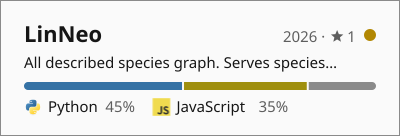</picture></a></td>
  </tr>
  <tr>
    <td><b>Renglón</b><br><code>layout: row</code><br>Una línea por repo; apilados se leen como un índice.</td>
    <td><a href="https://github.com/RemiH06/mapoDoufu"><picture><source media="(prefers-color-scheme: dark)" srcset="docs/gallery/row/card-mapoDoufu-dark.svg">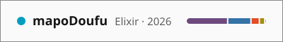</picture></a><br><a href="https://github.com/RemiH06/SaveTrack"><picture><source media="(prefers-color-scheme: dark)" srcset="docs/gallery/row/card-SaveTrack-dark.svg">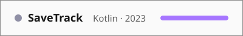</picture></a><br><a href="https://github.com/RemiH06/Ariadne"><picture><source media="(prefers-color-scheme: dark)" srcset="docs/gallery/row/card-Ariadne-dark.svg">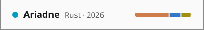</picture></a></td>
  </tr>
  <tr>
    <td><b>Bloque de stack</b><br><code>stack: stack.json</code><br><code>names: false</code><br>Un bloque por categoría con el ícono de cada tecnología, en el orden que le des. Sin <code>names: false</code>, cada ícono lleva su nombre al lado.</td>
    <td><picture><source media="(prefers-color-scheme: dark)" srcset="docs/gallery/stack/stack-languages-dark.svg">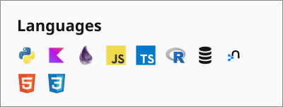</picture></td>
  </tr>
  <tr>
    <td><b>Banner pizarrón</b><br><code>banner: true</code><br>Tu texto (o tu usuario) en gis de doble trazo sobre una rejilla hexagonal, que se escribe al cargar.</td>
    <td><picture><source media="(prefers-color-scheme: dark)" srcset="docs/gallery/banner/banner-dark.svg"></picture></td>
  </tr>
  <tr>
    <td><b>Hexagramas</b><br><code>iching: true</code><br>Tus últimas 52 semanas como hexagramas del I Ching: lunes a viernes son las líneas 1 a 5 y el fin de semana la 6, entera si contribuiste. Al cargar giran hacia la semana más reciente y se enderezan.</td>
    <td><picture><source media="(prefers-color-scheme: dark)" srcset="docs/gallery/iching/iching-dark.svg"></picture></td>
  </tr>
  <tr>
    <td><b>Matriz Glyph</b><br><code>matrix: text, pulse, fluid</code><br>Los 489 LEDs de la matriz del Nothing Phone (3): tu texto (o tu usuario) en letras de 5×5 que corren de derecha a izquierda, una onda que sale del centro o manchas de luz que derivan.</td>
    <td><picture><source media="(prefers-color-scheme: dark)" srcset="docs/gallery/matrix/matrix-text-dark.svg">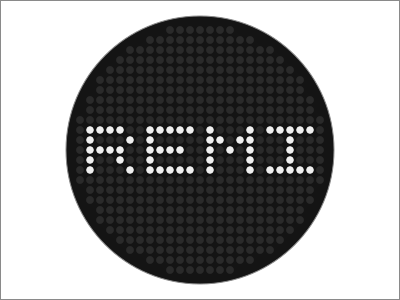</picture><br><picture><source media="(prefers-color-scheme: dark)" srcset="docs/gallery/matrix/matrix-fluid-dark.svg">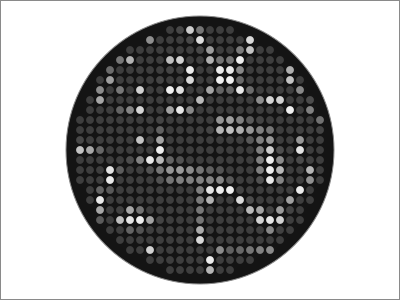</picture></td>
  </tr>
  <tr>
    <td><b>Nixie</b><br><code>nixie: commits, stars</code><br>Tus commits del año o las estrellas de tus repos públicos en tubos nixie que recorren sus cátodos al cargar.</td>
    <td><picture><source media="(prefers-color-scheme: dark)" srcset="docs/gallery/nixie/nixie-commits-dark.svg"></picture><br><picture><source media="(prefers-color-scheme: dark)" srcset="docs/gallery/nixie/nixie-stars-dark.svg"></picture></td>
  </tr>
  <tr>
    <td><b>Ferrofluido</b><br><code>ferrofluid: true</code><br>Decorativo, sin datos: gotas que se funden y separan, de las que solo se ven dos bandas de luz en su contorno. Tres manchas, una por color, cuyas bandas se cruzan como cáusticas.</td>
    <td><picture><source media="(prefers-color-scheme: dark)" srcset="docs/gallery/ferrofluid/ferrofluid-dark.svg">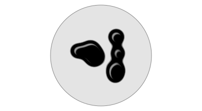</picture></td>
  </tr>
  <tr><td><b>Objeto 3D</b></td><td>En camino: un modelo <code>.glb</code> propio o una bola disco girando lento.</td></tr>
  <tr>
    <td><b>Colofón</b><br><code>stack: stack.json</code><br><code>colofon: true</code><br><code>names: false</code><br>Tu stack como bandas de logos que corren en loop, una por categoría, cada una teñida de su color. Sin <code>names: false</code>, cada logo lleva su nombre al lado.</td>
    <td><picture><source media="(prefers-color-scheme: dark)" srcset="docs/gallery/colofon/colofon-languages-dark.svg"></picture><br><picture><source media="(prefers-color-scheme: dark)" srcset="docs/gallery/colofon/colofon-databases-dark.svg"></picture><br><picture><source media="(prefers-color-scheme: dark)" srcset="docs/gallery/colofon/colofon-data-viz-dark.svg"></picture></td>
  </tr>
</table>

El punto junto al nombre es el estado del proyecto: azul activo, amarillo en
pausa, gris concluido, rojo descontinuado. Los colores de la barra son los de
GitHub para cada lenguaje.

## Instalación

1. En el repo de tu perfil (`tuUsuario/tuUsuario`), crea `.github/workflows/widgets.yml`:

   ```yaml
   name: widgets

   # Cada día, al cambiar main o a mano: genera los SVG y los publica en la
   # rama `widgets`, un solo commit que se reescribe. Si nada cambió, no hay commit.
   on:
     schedule:
       - cron: '23 6 * * *'
     workflow_dispatch:
     push:
       branches: [main]

   permissions:
     contents: write

   concurrency:
     group: widgets

   jobs:
     widgets:
       runs-on: ubuntu-latest
       steps:
         - uses: actions/checkout@v4

         - uses: RemiH06/ReadMyWidgets@v1
           with:
             pinned: ${{ github.repository_owner }}
             status: |
               miRepo:activo
               otroRepo:pausa
             stack: stack.json
             layout: compact
             out: widgets
             base: https://raw.githubusercontent.com/${{ github.repository }}/widgets

         - name: Publicar en la rama widgets
           working-directory: widgets
           run: |
             git init -q -b widgets
             git add .
             git -c user.name="github-actions[bot]" -c user.email="41898282+github-actions[bot]@users.noreply.github.com" commit -qm "widgets: $(date -u +%F)"
             remote="https://x-access-token:${{ github.token }}@github.com/${{ github.repository }}.git"
             # Mismo árbol que lo ya publicado: no hay nada que empujar.
             if git fetch -q --depth=1 "$remote" widgets && [ "$(git rev-parse HEAD^{tree})" = "$(git rev-parse FETCH_HEAD^{tree})" ]; then
               echo "Sin cambios."
               exit 0
             fi
             git push -qf "$remote" widgets
   ```

2. Córrelo una vez a mano (Actions → widgets → Run workflow). En el resumen de
   la corrida queda el HTML listo para pegar en tu README: un `<picture>` por
   widget, con versión oscura y clara, enlace al repo y `alt` con su nombre y
   descripción.

3. Pega ese HTML en tu README. Desde ahí, cuando cambies la descripción, los
   lenguajes o los fijados de un repo, la ficha se actualiza sola en la
   siguiente corrida.

Si prefieres elegir los repos en vez de usar los fijados, cambia `pinned` por
`repos`, uno por renglón, cada uno con su status:

```yaml
repos: |
  tuUsuario/miRepo:activo
  https://github.com/tuUsuario/otroRepo:concluido
```

`stack.json` es un objeto de categoría → lista de tecnologías, en el orden en
que quieres verlas. El ícono se busca por nombre en devicon; si el nombre que
muestras no es el del ícono, dalo aparte:

```json
{
  "Languages": ["Python", "Kotlin", { "name": "SQL", "icon": "postgresql" }],
  "Data & ML": ["pandas", "PyTorch", "statsmodels"]
}
```

Lo que no tiene ícono sale solo con su nombre. Un ícono que no se distingue
del fondo (negro en el tema oscuro, blanco en el claro) se pinta con el color del
texto; uno que tiene partes oscuras y partes de color, como pandas en el tema
oscuro, se deja como viene y se reconoce por las partes que sí se ven.

### Sin Action

Con Node 24 o más reciente y nada más (sin `npm install`), el mismo generador
corre en local:

```bash
git clone https://github.com/RemiH06/ReadMyWidgets.git
cd ReadMyWidgets
node src/cli.js --repos tuUsuario/repo:activo,tuUsuario/otro:pausa --layout compact --out widgets
node src/cli.js --pinned tuUsuario --status repo:activo --stack stack.json --out widgets
node src/cli.js --nixie commits,stars --user tuUsuario --out widgets
node src/cli.js --banner --text "Hola, soy yo" --out widgets
node src/cli.js --stack stack.json --colofon --out widgets
node src/cli.js --iching --user tuUsuario --out widgets
node src/cli.js --matrix text,pulse --text "Hola" --out widgets
node src/cli.js --ferrofluid --out widgets
```

Escribe los SVG en `widgets/` e imprime el HTML para tu README. Las opciones
son las mismas que los inputs, con `--` (`--repos`, `--pinned`…); el token va en
la variable de entorno `GITHUB_TOKEN`.

## Argumentos

- `repos` Lista de `dueño/repo` o `https://github.com/dueño/repo`, uno por renglón o separados por coma, cada uno con `:status` opcional: `activo`, `pausa`, `concluido` o `descontinuado` (también `active`, `paused`, `done`, `discontinued`). Sin status, un repo archivado sale como descontinuado.
- `pinned` En lugar de `repos`: los repos fijados de ese usuario u organización, en su orden.
- `status` Lista de `repo:status` (o `dueño/repo:status`) para los repos que no lo traen, como los de `pinned`. Un nombre que no esté entre los repos es error.
- `stack` Ruta a un `stack.json` en tu repo; genera un bloque por categoría (`stack-<categoría>-dark.svg` y `-light.svg`).
- `colofon` `true` para dibujar `stack` como el colofón: una banda de logos en loop por categoría (`colofon-<categoría>-dark.svg` y `-light.svg`) en vez de bloques. Los logos van en la versión de un color de devicon, teñidos con el color de la banda. Cada banda es un SVG y el HTML las apila con `<br>`.
- `names` `false` para que el stack y el colofón muestren solo los íconos, sin el nombre al lado (en el CLI, `--no-names`). Sin nombres, los íconos del bloque de stack crecen de 18 a 28 px. Una tecnología sin ícono conserva su nombre, y todas siguen en el texto alternativo. Por defecto, `true`.
- `layout` `card` (por defecto), `compact` o `row`.
- `nixie` Lista de cifras en tubos nixie: `stars` (estrellas de los repos públicos de `user`, sin forks) y `commits` (sus commits del año en curso). Un archivo por cifra: `nixie-stars-dark.svg`, `nixie-commits-dark.svg` y sus `-light.svg`.
- `user` De quién son las cifras del nixie y los hexagramas, y el texto del banner y de la matriz si no das `text`; por defecto, el dueño del repo donde corre la Action. En el CLI es obligatorio con `--nixie` y `--iching`.
- `banner` `true` para el banner pizarrón (`banner-dark.svg` y `-light.svg`).
- `text` Texto del banner y de la matriz en modo `text`. Si no cabe en 2 líneas del banner, o una palabra no cabe en una, la corrida falla en vez de cortarlo.
- `matrix` Lista de modos de la matriz Glyph, un archivo por modo (`matrix-text-dark.svg` y `-light.svg`, etc.): `text` (`text`, o `user`, en letras de 5×5; si cabe se queda quieto, si no corre un LED por paso), `pulse` (una onda que sale del centro) y `fluid` (manchas de luz que derivan). Las letras son A-Z, 0-9, espacio y `- . , : ! ?`; los acentos se quitan y cualquier otro carácter hace fallar la corrida.
- `ferrofluid` `true` para el ferrofluido (`ferrofluid-dark.svg` y `-light.svg`): bandas de luz animadas, sin datos.
- `iching` `true` para tus últimas 52 semanas completas (lunes a domingo) como hexagramas del I Ching (`iching-dark.svg` y `-light.svg`). Línea entera si ese día, o ese fin de semana, tuvo al menos una contribución; partida si no.
- `background` `solid` o `transparent`: sin relleno en la caja, solo el borde, para que el widget quede sobre el fondo de GitHub. Sin él, las fichas y el stack llevan caja y los widgets decorativos (banner, nixie, hexagramas, colofón, matriz, ferrofluido) no; si lo das, aplica a todos. Sin caja, los colores de lenguaje y de íconos se ajustan contra el fondo de la página en vez del de la caja.
- `out` Carpeta de salida: `widgets` en la Action, `out` en el CLI.
- `base` Ruta o URL de los SVG vista desde tu README, para el HTML que se imprime; por defecto, la de `out`. Si publicas en la rama `widgets`, es `https://raw.githubusercontent.com/<dueño>/<repo>/widgets`.
- `token` Por defecto el `GITHUB_TOKEN` del workflow, que alcanza también para `pinned`. En el CLI es la variable de entorno `GITHUB_TOKEN`: opcional con `--repos` (sin token la API permite 60 peticiones por hora), obligatoria con `--pinned`, `--nixie` e `--iching`.

Si algo falla (un repo que no existe, un `stack.json` mal formado, un widget de
más de 100 KB), no se escribe ningún archivo, la corrida falla y el mensaje dice
cuál entrada y por qué.

## Características

- SVG autocontenidos: fuente RMW Sans (subset de Hubot Sans, OFL) e íconos de devicon incrustados.
- Tema oscuro y claro de cada widget, con contraste WCAG verificado por pruebas.
- Texto medido con las métricas reales de la fuente y cortado con "…": nunca se desborda.
- Legible en el teléfono: el texto más chico no baja de 12 px al escalar a la columna.
- Salida determinista: mismos datos, mismos bytes.
- Sin dependencias de npm ni paso de build.

## Funciones futuras

- Los widgets decorativos de la galería.

## Créditos

Íconos de [devicon](https://github.com/devicons/devicon) (MIT). Colores de lenguaje de
[GitHub Linguist](https://github.com/github-linguist/linguist) (MIT). Hubot Sans de GitHub (OFL, ver `fonts/OFL.txt`).

## Autoría

por Hex ([@RemiH06](https://github.com/RemiH06))
